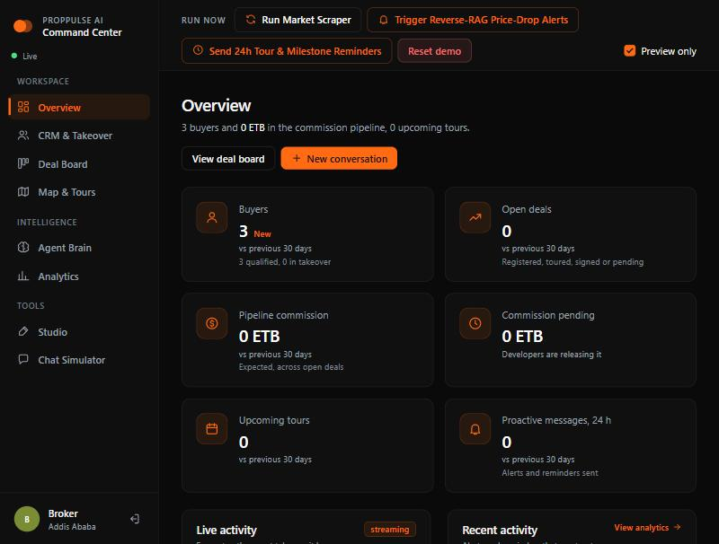
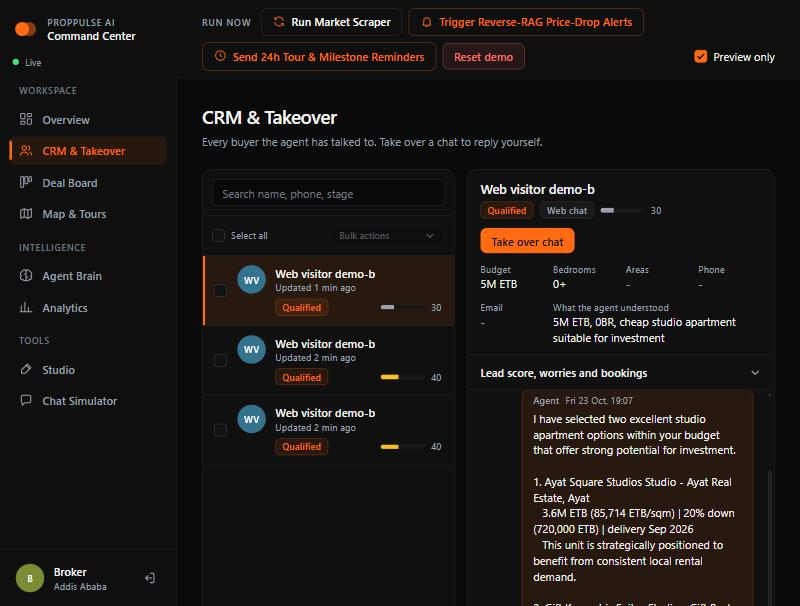
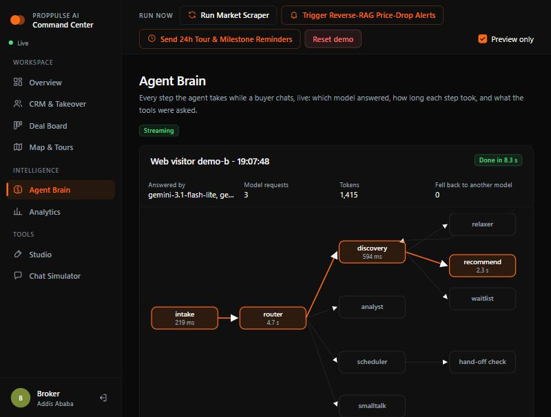
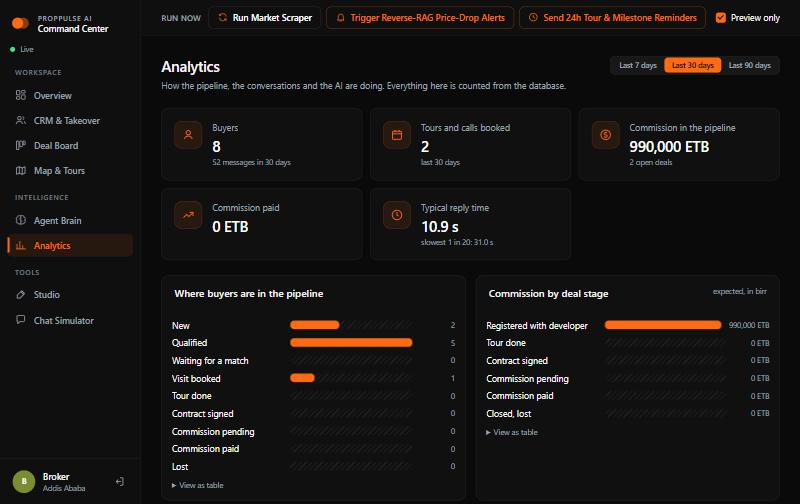
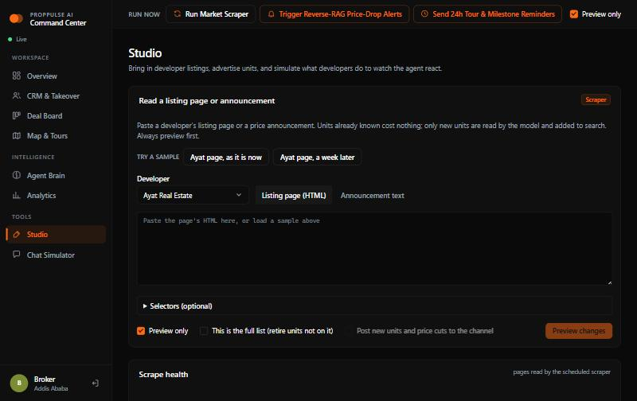

# PropPulse AI

An AI sales assistant for an independent real-estate broker in Addis Ababa. Buyers chat on Telegram in English or Amharic; the agent finds matching units, answers worries from stored facts, books site visits and calls, and sends proactive follow-ups. The broker watches and steers everything from a live Command Center.

**Stack:** FastAPI · LangGraph · Gemini · Supabase Postgres + pgvector · Next.js 14 · Telegram · Google Calendar · Mapbox · Cloud Run + Vercel.

## How it fits together

```
 Buyer ── Telegram / web chat ──▶ FastAPI ──▶ LangGraph agent ──▶ Gemini (text, structured, embeddings, voice, images)
                                     │              │
        Cloud Scheduler ─────────────┤              ├─▶ Supabase Postgres + pgvector (units, buyers, chats, checkpoints, event log)
        (proactive, reminders,       │              ├─▶ Google Calendar (availability, bookings)
         market scrape)              │              └─▶ Mapbox (routes), Resend (developer emails)
                                     ▼
                       Durable event log ──live stream──▶ Next.js Command Center (CRM, takeover, board, map, brain, analytics, studio)
```

**The agent graph:** `intake` (language, prompt-injection and hand-off checks, history compaction) → `router` (buttons parsed in code, model only for free text) → one of `discovery` (hybrid + reverse search, ranking), `relaxer` (widens filters when nothing fits), `recommend`, `details`, `affordability`, `analyst` (comparisons), `scheduler` (visits and calls) → `human_gate`, `handoff` or `smalltalk`. Every step is traced, and each model request and tool call shows up in the dashboard timeline.

## What makes it dependable
- **Numbers are never invented.** Prices, payment plans, mortgage estimates and rankings are computed in code (`app/finance.py`); the model only words them. A groundedness check verifies every figure in every reply against the unit facts or the buyer's own words.
- **Measured, not just demonstrated.** An evaluation suite replays recorded model answers for free and fails the build if quality drops (table below).
- **Safe by construction.** Prompt-injection and abuse guardrails, secrets stripped from every log line, rate limits on public endpoints, a block on repeated wrong keys, row-level security on every table. See [SECURITY.md](SECURITY.md).
- **Works offline.** Anything without credentials runs on a built-in mock, so the whole system can be tried without keys.
- **Respectful scraping.** robots.txt, pacing, size caps, private-address refusal, a refusal to wipe the catalogue after a suspiciously small scrape, plus a health card that flags broken sources.

## Evaluation (replayed from a recording, 27 seconds, no network)

| Check | Result |
|---|---|
| Retrieval, 58 labelled buyer messages (English, Amharic, mixed; 14 deliberately hard) | hit@3 **100%**, MRR **0.99**, precision@3 **83%** |
| Requests nothing matches | returned empty **5 of 5** |
| Filter widening recovers a match | **100%** |
| Conversation scenarios through the real graph (search, booking, conflicts, consultations, takeover, voice, ad links, alerts, injection, Amharic, hand-off, affordability) | **28 / 28** |
| Replies whose every figure is grounded | **44 / 44** |

`python -m evals --check` fails if anything gets worse; the same guard runs inside `pytest` and CI. Full tables: [backend/evals/REPORT.md](backend/evals/REPORT.md). Method and limits: [backend/evals/README.md](backend/evals/README.md).

## Features
- **Chat agent:** preference extraction, hybrid and reverse vector search, ranking by price, size, yield or developer reliability, comparisons, brochures (PDF), payment plans, bank-loan affordability estimates, conversation memory, Amharic replies.
- **Bookings:** Google Calendar availability, Mapbox route ordering for multi-stop tours, phone consultations, lead emails, commission ledger, pre-tour dossier.
- **Proactive jobs:** price-drop alerts to matching buyers, price-increase notices to the broker, new-listing matches, 24 h tour and milestone reminders (idempotent, scheduler-triggered).
- **Market ingestion:** reads developer pages (CSS selectors or a browser for JavaScript pages) or pasted announcements and webhooks; only new units cost a model call.
- **Projects (price on request):** most Addis developers publish projects, not unit prices. The bot lists matching projects with an **Ask the price** button; the broker is told, enters the price once, and every waiting buyer is messaged. Projects come from a polite same-site crawl or by hand, and live offers are advertised to the channel once each.
- **Channel ads:** composes and posts listings with Ask / Compare / Book buttons that deep-link back to the bot. Real posts need an explicit second step.

## The Command Center

| Page | What it does |
|---|---|
| Overview | Live numbers, activity and the proactive messages that went out |
| CRM & Takeover | Every buyer, the full chat, voice notes, one-click takeover, and a panel explaining the lead score signal by signal |
| Deal Board | Drag deals through the commission stages; each card links to its dossier |
| Agent Brain | The live graph and a timeline of every step with model requests, tokens, fall-backs and tool calls |
| Map & Tours | Mapbox map with price pins, clusters and driving routes (falls back to a drawn map without a token) |
| Analytics | Pipeline, commission, messages per day, lead scores, worries, reply time, model usage, evaluation results |
| Studio | Read listing pages and announcements, floor plans, price simulator, channel ads, scrape health |
| Chat Simulator | Talk to the agent as a buyer, with the same buttons Telegram shows |

| Page | Look |
|---|---|
| Overview |  |
| CRM and takeover |  |
| Agent Brain |  |
| Analytics |  |
| Studio |  |

The dashboard is near-black with one orange accent, grouped navigation, KPI cards that show how each figure moved against the previous 30 days, a Deal Board with a styled "Move to" menu, and bulk select with CSV export on the CRM list. It works on a phone.

## Run it

```bash
cd backend
python -m venv .venv && .venv/Scripts/pip install -r requirements.txt -r requirements-dev.txt
cp .env.example .env          # fill in keys (only GEMINI_API_KEY and the database are essential)
.venv/Scripts/python -m scripts.migrate
.venv/Scripts/python -m scripts.seed
.venv/Scripts/python -m app   # http://localhost:8000
```
Start the server with `python -m app`, not `uvicorn`: on Windows the database driver needs the event loop that launcher selects.

```bash
cd frontend
cp .env.example .env.local    # backend URL, admin key, dashboard password
npm install && npm run dev    # http://localhost:3000
```

Or everything in containers: `cp .env.docker.example .env && docker compose up --build`.

## Several Gemini keys
Set `GEMINI_API_KEYS` in `backend/.env` to a comma-separated list (the first key is `GEMINI_API_KEY`). Each key runs the whole model chain; when every model on a key is out of quota or rate-limited, the next key takes over, the same request is retried, and the first key is tried again after six hours. Text, structured output, voice, images and embeddings all rotate, so the agent and the market sweep share it. `/health` shows how many keys are loaded. Keys are redacted from logs.

## Checks
```bash
cd backend
.venv/Scripts/python -m pytest              # ~745 tests, offline, on an embedded Postgres + pgvector
.venv/Scripts/python -m pytest --live       # also the tests that call the real Gemini API
.venv/Scripts/python -m evals --check       # quality guard from the recording
.venv/Scripts/python -m ruff check . && .venv/Scripts/python -m mypy
cd ../frontend && npm run lint && npm run typecheck && npm test && npm run build
npm run e2e                                  # Playwright, needs a running stack
```
GitHub Actions runs all of this plus a Docker build on every push ([.github/workflows/ci.yml](.github/workflows/ci.yml)).

## Deploy
Supabase + Cloud Run + Vercel, scripted: [docs/DEPLOYMENT.md](docs/DEPLOYMENT.md). Design choices and the reasons for them: [docs/DECISIONS.md](docs/DECISIONS.md). Checks that need a real browser, real accounts or a native Amharic reader: `docs/MANUAL_TESTS_PHASE*.md`.

## Layout
| Path | Contents |
|---|---|
| `backend/app` | FastAPI app, agent graph, finance, guardrails, ingestion, ads, proactive jobs, observability |
| `backend/migrations` | SQL schema 001–009 |
| `backend/evals` | Evaluation suite, recordings and reports |
| `backend/scripts` | `migrate`, `seed`, live checks, `post_deploy_check` |
| `backend/tests` | pytest suite |
| `frontend` | Next.js dashboard, vitest and Playwright tests |
| `deploy` | Cloud Run and Scheduler scripts |

## Live integrations
Google Calendar (service account shared on the calendar with "Make changes to events") and Mapbox switch on automatically once their keys are set (`GOOGLE_SERVICE_ACCOUNT_JSON`, `GOOGLE_CALENDAR_ID`, `MAPBOX_TOKEN`); force with `CALENDAR_BACKEND` / `ROUTING_BACKEND`. `NEXT_PUBLIC_MAPBOX_TOKEN` (a public `pk.` token) enables the live map. `DEMO_RESET_ENABLED=true` shows the Reset demo button on a demo instance. Never commit `.env` or the service-account file.

## Demo
To start a demo from a clean state, use **Reset demo** in the control bar (needs `DEMO_RESET_ENABLED=true`, and asks you to type RESET).
