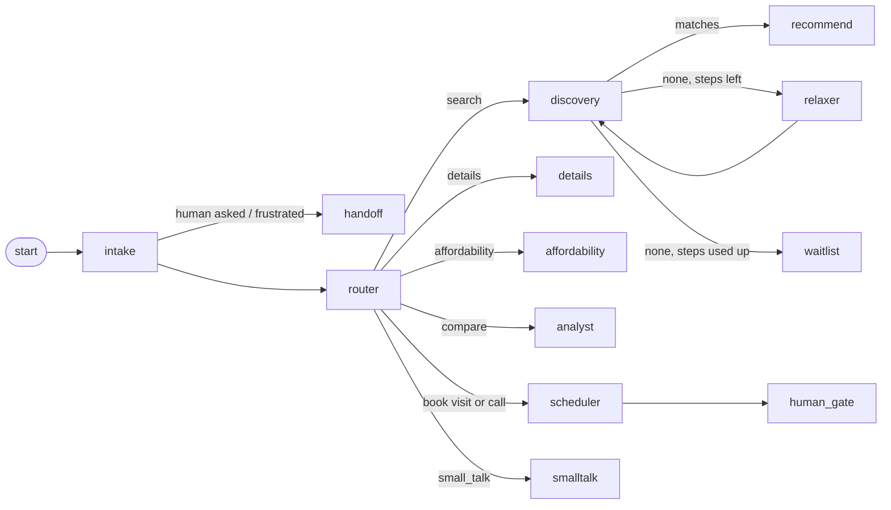

# PropPulse AI

An AI sales assistant for an independent real-estate broker in Addis Ababa. Buyers chat on Telegram or the web in English or Amharic; the agent finds matching units, answers worries from stored facts, books site visits and calls, protects the broker's commission, and follows up on its own. The broker watches and steers everything from a live Command Center.

**Stack:** FastAPI · **LangGraph** · Gemini · **Supabase Postgres + pgvector (RAG)** · Scrapy + scrapy-playwright · Next.js 14 · Telegram · Google Calendar · Mapbox · Render + Vercel + GitHub Actions (all free).

## Where to look first

| If you want to see... | Read |
|---|---|
| How LangGraph and RAG are used, step by step, with diagrams | [docs/ARCHITECTURE.md](docs/ARCHITECTURE.md) (summary below) |
| How listings get in without burning the model quota | [Two ingestion strategies](#two-ingestion-strategies) and [backend/scraper/README.md](backend/scraper/README.md) |
| Why each design choice was made | [docs/DECISIONS.md](docs/DECISIONS.md) |
| Proof that it works | [Evaluation](#evaluation-replayed-from-a-recording-27-seconds-no-network) and [backend/evals](backend/evals/README.md) |
| How it is deployed and operated | [docs/FREE_DEPLOYMENT.md](docs/FREE_DEPLOYMENT.md) (Render + Vercel + GitHub Actions) or [docs/DEPLOYMENT.md](docs/DEPLOYMENT.md) (Cloud Run) |
| Security posture | [SECURITY.md](SECURITY.md) |

## How it fits together

```
 Buyer ── Telegram / web chat ──▶ FastAPI ──▶ LangGraph agent ──▶ Gemini (text, structured, embeddings, voice, images)
                                     │              │
        GitHub Actions cron ─────────┤              ├─▶ Supabase Postgres + pgvector (units, projects, buyers, chats, checkpoints, event log)
        (reminders, daily run,       │              ├─▶ Google Calendar (availability, bookings)
         LLM sweep)                  │              └─▶ Mapbox (routes), Resend (developer emails)
                                     │
 Small developer sites ──▶ httpx + BeautifulSoup ──▶ Gemini ──┐
 Large portals ──▶ Scrapy on GitHub Actions ──▶ local extraction (Gemini only as a fallback) ──┤
                                     ▼                                                        ▼
                       Durable event log ──live stream──▶ Next.js Command Center      IngestionService ─▶ units / projects
                       (CRM, takeover, board, map, brain, analytics, studio, projects, portals)
```

### LangGraph: the agent
Each turn runs a LangGraph state machine and its state is checkpointed in Postgres, so conversations survive restarts.



- `intake`: language, prompt-injection and hand-off checks, voice-note transcription, history compaction.
- `router`: button taps and known phrases are parsed **in code**; only free text costs a model call (one structured extraction).
- `discovery` → `relaxer` → `discovery`: a bounded loop that widens the search by rule when nothing fits (budget +12% and neighbouring areas, then +24% and any area), without ever changing what the buyer actually asked for.
- `scheduler` → `human_gate`: books through the calendar, orders multi-stop routes, registers the lead with the developer; a high-value booking hands the chat to the broker.
- Every node is traced; the **Agent Brain** page draws the live graph and every step with timings, tokens and fall-backs.

### RAG: how search works
- **What is embedded:** every unit (type, area, size, price, description and floor-plan tags read by the vision model), every project, and every buyer's preferences (Gemini embeddings, 768 dimensions, pgvector with HNSW).
- **Forward search is hybrid:** hard SQL filters (available, budget, bedrooms, areas) first, then cosine similarity with a tuned floor (0.64) so weak matches are dropped, then a nudge toward the more reliable developer (`match_properties_hybrid`).
- **Rules beat similarity where they should:** "the cheapest" and "the largest" are deterministic SQL rankings with no embedding.
- **Reverse search:** a price drop or a new unit is matched against every buyer's preference vector (`match_buyers_for_property`) so the right people are messaged privately.
- **Retrieval is measured:** 58 labelled messages, hit@3 100%, MRR 0.99 (table below).

Details, file names and the SQL: [docs/ARCHITECTURE.md](docs/ARCHITECTURE.md).

## Two ingestion strategies

Listings arrive two ways and meet in one pipeline (`IngestionService`), which skips unchanged units for free, records price changes, and embeds only genuinely new units.

| | Small developer sites and announcements | Large portals |
|---|---|---|
| Sites | Ayat, Noah, Metropolitan, Jenboro, Phison, Temer, Kavod (+ pasted announcements and developer emails) | Ethiopia Property Centre, Live Ethio, GuzoHomes, Addis List, Ethio Betoch, EthioHome |
| Why this way | Pages are unpredictable; no selectors to maintain | Thousands of predictable pages; the model quota would be gone in a morning |
| How | Sitemap-seeded same-site crawl, page text to Gemini | **Scrapy** from each site's sitemap; local extraction from JSON-LD, embedded JSON, CSS hints, OpenGraph |
| Gemini use | one call per changed project page | **only** when no strict price is found locally (max 3 per batch of 25) |
| Saves | projects (price on request) | priced units |
| Where it runs | Render, started by the dashboard or the 06:00 job | GitHub Actions (free), started from the **Portals** page or on a schedule |

Guard rails: robots.txt and pacing everywhere; a bot-check page or a 403/429 stops that site and alerts you instead of being bypassed; a "strict price" must come from structured data and be a plausible birr sale price (a rent or a typo is refused); a crawl that sees far fewer listings than known never wipes the catalogue. The **Portals** page shows every run, and Telegram tells you when a site blocks the crawler, a crawl fails, or a site's layout changes. A buyer who books a portal unit is never sent to the portal: the broker is told and arranges it, so the lead stays theirs.

## What makes it dependable
- **Numbers are never invented.** Prices, payment plans, mortgage estimates and rankings are computed in code (`app/finance.py`); the model only words them. A groundedness check verifies every figure in every reply against the unit facts or the buyer's own words, and swaps in a plain layout if one is not found.
- **Measured, not just demonstrated.** An evaluation suite replays recorded model answers for free and fails the build if quality drops (table below).
- **Safe by construction.** Prompt-injection and abuse guardrails, secrets stripped from every log line, rate limits on public endpoints, a block on repeated wrong keys, row-level security on every table. See [SECURITY.md](SECURITY.md).
- **Works offline.** Anything without credentials runs on a built-in mock, so the whole system can be tried without keys.
- **Respectful scraping.** robots.txt, pacing, size caps, private-address refusal, a refusal to wipe the catalogue after a suspiciously small scrape, a health card that flags broken sources, and run alerts.
- **Survives quota.** A pool of Gemini keys and a model fall-back chain; the next key takes over when one is out of quota.

## Evaluation (replayed from a recording, 27 seconds, no network)

| Check | Result |
|---|---|
| Retrieval, 58 labelled buyer messages (English, Amharic, mixed; 14 deliberately hard) | hit@3 **100%**, MRR **0.99**, precision@3 **83%** |
| Requests nothing matches | returned empty **5 of 5** |
| Filter widening recovers a match | **100%** |
| Conversation scenarios through the real graph (search, booking, conflicts, consultations, takeover, voice, ad links, alerts, injection, Amharic, hand-off, affordability) | **28 / 28** |
| Replies whose every figure is grounded | **44 / 44** |

`python -m evals --check` fails if anything gets worse; the same guard runs inside `pytest` and CI. Full tables: [backend/evals/REPORT.md](backend/evals/REPORT.md). Method and limits: [backend/evals/README.md](backend/evals/README.md).

## Features
- **Chat agent:** preference extraction, hybrid and reverse vector search, ranking by price, size, yield or developer reliability, comparisons, brochures (PDF), payment plans, bank-loan affordability estimates, conversation memory, Amharic replies.
- **Bookings:** Google Calendar availability, Mapbox route ordering for multi-stop tours, phone consultations, lead emails to developers, commission ledger, pre-tour dossier. Portal units are arranged by the broker instead.
- **Proactive jobs:** price-drop alerts to matching buyers, price-increase notices to the broker, new-listing matches, 24 h tour and milestone reminders (idempotent, scheduler-triggered).
- **Market ingestion:** the two strategies above, plus pasted announcements and an inbound-email webhook; only new units cost a model call.
- **Projects (price on request):** most Addis developers publish projects, not unit prices. The bot lists matching projects with an **Ask the price** button; the broker is told, enters the price once, and every waiting buyer is messaged. Live offers are advertised to the channel once each.
- **Channel ads:** composes and posts listings with Ask / Compare / Book buttons that deep-link back to the bot. Real posts need an explicit second step.

## The Command Center

| Page | What it does |
|---|---|
| Overview | Live numbers, activity and the proactive messages that went out |
| CRM & Takeover | Every buyer, the full chat, voice notes, one-click takeover, and a panel explaining the lead score signal by signal |
| Deal Board | Drag deals through the commission stages; each card links to its dossier |
| Map & Tours | Mapbox map with price pins, clusters and driving routes (falls back to a drawn map without a token) |
| Projects | Developers' projects, price requests, offers, photos and videos, and the LLM market sweep |
| **Portals** | Start the portal crawler, see every run (status, counts, share priced without the model, GitHub log) and which portal needs attention |
| Agent Brain | The live graph and a timeline of every step with model requests, tokens, fall-backs and tool calls |
| Analytics | Pipeline, commission, messages per day, lead scores, worries, reply time, model usage, evaluation results |
| Studio | Read listing pages and announcements, floor plans, price simulator, channel ads, scrape health |
| Chat Simulator | Talk to the agent as a buyer, with the same buttons Telegram shows |

| Page | Look |
|---|---|
| Overview |  |
| CRM and takeover |  |
| Agent Brain |  |
| Analytics |  |
| Studio |  |

The dashboard is near-black with one orange accent, grouped navigation, KPI cards that show how each figure moved against the previous 30 days, a Deal Board with a styled "Move to" menu, and bulk select with CSV export on the CRM list. It works on a phone.

## Run it

```bash
cd backend
python -m venv .venv && .venv/Scripts/pip install -r requirements.txt -r requirements-dev.txt
cp .env.example .env          # fill in keys (only GEMINI_API_KEY and the database are essential)
.venv/Scripts/python -m scripts.migrate
.venv/Scripts/python -m scripts.seed
.venv/Scripts/python -m app   # http://localhost:8000
```
Start the server with `python -m app`, not `uvicorn`: on Windows the database driver needs the event loop that launcher selects.

```bash
cd frontend
cp .env.example .env.local    # backend URL, admin key, dashboard password
npm install && npm run dev    # http://localhost:3000
```

Or everything in containers: `cp .env.docker.example .env && docker compose up --build`.

The portal crawler (optional, separate dependencies):
```bash
cd backend
pip install -r requirements-scraper.txt
scrapy crawl portals -a site=guzohomes -a limit=20 -O out.jsonl   # writes a file, touches nothing
```
Starting it from the dashboard needs a GitHub token; see [backend/scraper/README.md](backend/scraper/README.md).

## Several Gemini keys
Set `GEMINI_API_KEYS` in `backend/.env` to a comma-separated list (the first key is `GEMINI_API_KEY`). Each key runs the whole model chain; when every model on a key is out of quota or rate-limited, the next key takes over, the same request is retried, and the first key is tried again after six hours. Text, structured output, voice, images and embeddings all rotate, so the agent and the market sweep share it. `/health` shows how many keys are loaded. Keys are redacted from logs.

## Checks
```bash
cd backend
.venv/Scripts/python -m pytest              # ~860 tests, offline, on an embedded Postgres + pgvector
.venv/Scripts/python -m pytest --live       # also the tests that call the real Gemini API
.venv/Scripts/python -m evals --check       # quality guard from the recording
.venv/Scripts/python -m ruff check . && .venv/Scripts/python -m mypy
cd ../frontend && npm run lint && npm run typecheck && npm test && npm run build
npm run e2e                                  # Playwright, needs a running stack
```
GitHub Actions runs all of this plus a Docker build on every push ([.github/workflows/ci.yml](.github/workflows/ci.yml)).

## Deploy
The live setup is free: Supabase (database), a Render web service (backend), Vercel (dashboard), GitHub Actions (schedules and the portal crawler): [docs/FREE_DEPLOYMENT.md](docs/FREE_DEPLOYMENT.md). A scripted Supabase + Cloud Run + Vercel alternative is in [docs/DEPLOYMENT.md](docs/DEPLOYMENT.md). Design choices and the reasons for them: [docs/DECISIONS.md](docs/DECISIONS.md). Checks that need a real browser, real accounts or a native Amharic reader: `docs/MANUAL_TESTS_PHASE*.md`.

## Layout
| Path | Contents |
|---|---|
| `backend/app` | FastAPI app, agent graph, finance, guardrails, ingestion, portal runs, ads, proactive jobs, observability |
| `backend/app/agent` | LangGraph graph, nodes, state, checkpointer, prompts, lead scoring |
| `backend/app/ingest` | Fetching, parsing, the portal page reader, the ingestion service, project crawling |
| `backend/scraper` | The Scrapy portal crawler: spider, per-site configuration, pipeline to the backend |
| `backend/migrations` | SQL schema 001–015 |
| `backend/evals` | Evaluation suite, recordings and reports |
| `backend/scripts` | `migrate`, `seed`, live checks, `post_deploy_check` |
| `backend/tests` | pytest suite |
| `frontend` | Next.js dashboard, vitest and Playwright tests |
| `deploy` | Cloud Run and Scheduler scripts |
| `.github/workflows` | CI, scheduled jobs, the portal crawl |
| `docs` | Architecture, decisions, deployment, demo script, manual test lists |

## Live integrations
Google Calendar (service account shared on the calendar with "Make changes to events") and Mapbox switch on automatically once their keys are set (`GOOGLE_SERVICE_ACCOUNT_JSON`, `GOOGLE_CALENDAR_ID`, `MAPBOX_TOKEN`); force with `CALENDAR_BACKEND` / `ROUTING_BACKEND`. `NEXT_PUBLIC_MAPBOX_TOKEN` (a public `pk.` token) enables the live map. `GITHUB_TOKEN` and `GITHUB_REPO` let the dashboard start the portal crawl. `DEMO_RESET_ENABLED=true` shows the Reset demo button on a demo instance. Never commit `.env` or the service-account file.

## Demo
To start a demo from a clean state, use **Reset demo** in the control bar (needs `DEMO_RESET_ENABLED=true`, and asks you to type RESET).
