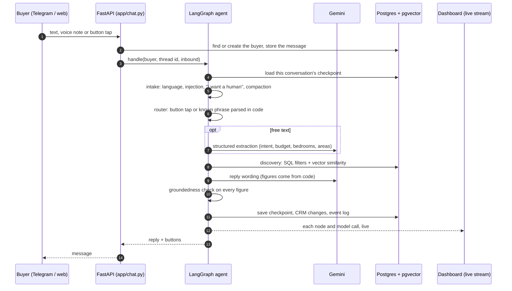
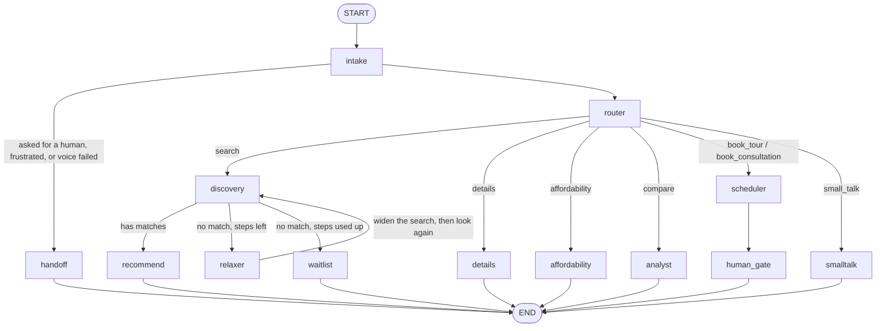
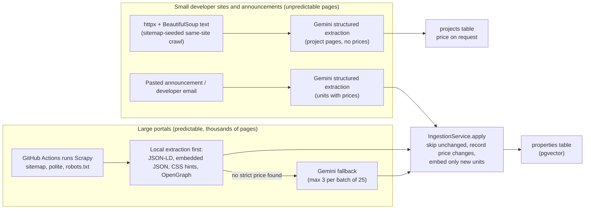
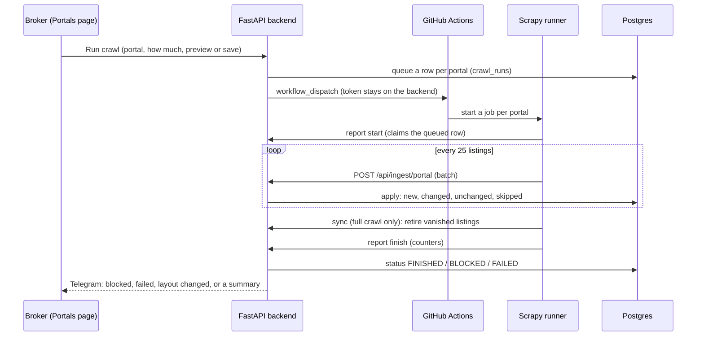

# Architecture: how LangGraph, RAG and ingestion work in PropPulse AI

This is the long version of the README's "How it works". Every claim below names the file that implements it, so it can be checked.

1. [A buyer's message, end to end](#1-a-buyers-message-end-to-end)
2. [LangGraph: the agent](#2-langgraph-the-agent)
3. [RAG: how search works](#3-rag-how-search-works)
4. [Keeping the numbers honest](#4-keeping-the-numbers-honest)
5. [Ingestion: two strategies, one pipeline](#5-ingestion-two-strategies-one-pipeline)
6. [The portal crawler and the Portals page](#6-the-portal-crawler-and-the-portals-page)
7. [Proactive jobs and the broker's controls](#7-proactive-jobs-and-the-brokers-controls)
8. [Data model](#8-data-model)
9. [Where things run](#9-where-things-run)
10. [The public site and the Client Portal](#10-the-public-site-and-the-client-portal)

---

## 1. A buyer's message, end to end



Entry point `app/chat.py`; the graph is `app/agent/graph.py`; the nodes are `app/agent/nodes.py`.

## 2. LangGraph: the agent

LangGraph models the conversation as a state machine. Each turn starts at `START`, flows through nodes, and ends at `END`. Between turns the state is saved, so the agent remembers the buyer.



| Node | What it does | Model call? |
|---|---|---|
| `intake` | Detects Amharic or English, flags prompt-injection, detects "let me talk to a person" or frustration (hand-off), transcribes voice notes, and summarises old history after 40 messages | only to transcribe audio or compact history |
| `router` | Works out what the buyer wants. Button taps and known phrases are parsed **in code**; only free text goes to the model, as one structured extraction (`Extraction` in `schemas.py`). Updates the CRM row and the lead score | free text only |
| `discovery` | Finds units (section 3) | one embedding |
| `relaxer` | When nothing matches, widens the search by rule: step 1 raises the budget by 12% and adds neighbouring areas, step 2 raises it by 24% and drops the area filter. The buyer's real preferences are never changed, only the search scope | none |
| `recommend` | Writes the answer for up to three matches, says if the search was widened, and appends matching projects | wording only |
| `waitlist` | Nothing fits even after widening: moves the buyer to `INVENTORY_PENDING`, so the next matching listing alerts them | wording only |
| `details` | Answers questions about a chosen unit from stored facts and the floor-plan tags | wording only |
| `affordability` | Mortgage and affordability, computed in `app/finance.py` | wording only |
| `analyst` | Compares options: price per m², payment plan, developer reliability | wording only |
| `scheduler` | Books a site visit or a phone call: calendar availability, route order, lead registration to the developer, the brochure PDF, the pre-tour dossier. For a unit read from a portal it tells the broker instead (section 6) | none |
| `human_gate` | After a booking above the high-value threshold (20M ETB) the chat is handed to the broker | none |
| `handoff` | Hands the chat to the broker and tells the buyer | none |

**State** (`app/agent/state.py`) is one typed dictionary. Persistent fields: `messages`, `buyer_preferences`, `buyer_profile`, `deal_stage`, `active_matches` (the options the buyer was just shown, in the order shown, so "book the second one" means the right unit), `conversation_summary`. Everything else (`intent`, `query_embedding`, `search_scope`, `reply`, ...) is rebuilt every turn by `intake`.

**Checkpointer** (`app/agent/checkpointer.py`): `AsyncPostgresSaver` stores the state after every node in Postgres (`thread_id` per buyer). A server restart or a redeploy does not lose a conversation. It falls back to in-memory only if Postgres is unusable, and the checkpoint tables have row-level security like every other table.

**Human takeover:** when the broker takes a chat over in the dashboard (or the agent hands over by itself), the agent stops running: no node executes and no model is called. Each buyer message is stored, written into the same history through `add_message` (so after hand-back the agent has the whole conversation), and relayed to the broker's Telegram chat as `Name: text`, but never back into the chat it came from. The buyer is told once, in their own language, that the broker has the chat, and not again for 30 minutes, so a silence is not mistaken for a broken bot (`_while_broker_has_the_chat` in `app/chat.py`).

**Tracing:** each node is wrapped (`traced`) so every model request carries the node name and buyer. `BrokerAgent.handle` streams node updates; the dashboard's **Agent Brain** page draws the graph live and lists every step with timings, tokens, fall-backs and tool calls.

**What code decides, not the model:** button taps, the widening rule, ranking ("cheapest", "largest"), every price and payment figure, lead scoring (`scoring.py`: named signals worth points, total exactly 100), the hand-off rules and the booking flow.

## 3. RAG: how search works

RAG here means: retrieve real units from the database by meaning **and** by hard filters, then let the model *word* the answer from what was retrieved. It never answers from memory.

### What is embedded
| Thing | Text that is embedded | Where |
|---|---|---|
| A unit | `"<project> - <type> in <area>, Addis Ababa. <n> bedrooms, <size> sqm, <price> ETB. <description> Features: <floor-plan tags>."` | `app/ingest/text.py` |
| A project (price on request) | name, area, bedrooms, sizes and the developer's summary | `app/projects.py` |
| A buyer's preferences | budget, bedrooms, areas and what they asked for, built from their last messages | `_refresh_preference_vector` in `nodes.py` |
| A buyer's query | the free-text search the router extracted | `embed_query` |

Model `gemini-embedding-001`, 768 dimensions, with the task type set for documents or queries (`app/embeddings.py`). Floor plans are read by the vision model into short tags ("maid room + bath", "corner balcony") that become part of the unit's text, so a buyer asking for a "separate maid room" can find it.

### Forward search: buyer to units (hybrid)
`match_properties_hybrid` (`migrations/002`) runs inside Postgres:
1. **Hard SQL filters first:** available units only, price at most the budget, bedrooms at least the minimum, area in the buyer's list.
2. **Then cosine similarity** between the query vector and each unit's `embedding` (pgvector, HNSW index), with a **similarity floor**: weak matches are dropped rather than shown. The floor is the `SIMILARITY_THRESHOLD` setting, **0.64**, tuned on the seed data so that known non-matches score at most 0.606 and real matches at least 0.666 (the SQL function's own default is 0.65 and is always overridden by the setting).
3. It fetches three times the wanted count, and among near-equal matches the developer with the better reliability score comes first (`rank_by_reliability`), then the top three are returned.

### Ranking rules instead of similarity
"The cheapest", "the largest", "best yield" are not descriptions, they are rules. `rank_properties` sorts the units that fit the buyer's limits by a fixed list of orderings; no embedding is involved, and the column and direction can never come from text.

### When nothing fits: the widening loop
`discovery` → no matches → `relaxer` widens (section 2) → `discovery` again, at most twice, then `waitlist`. The reply says exactly how the search was widened.

### Reverse search: unit to buyers
When a price drops or a unit is new, `match_buyers_for_property` (`migrations/004`) runs the same filters and floor from the unit's side against every buyer's preference vector. Buyers who already own a deal, or have told us nothing, are never contacted. The daily job turns the result into private Telegram messages (max one alert per buyer per day, up to three properties).

### Projects
Developers that publish no unit prices are stored as **projects** with their own embedding. They are shown beside priced results ("Also worth a visit"), found by area or by meaning (the same kind of similarity floor). The buyer taps **Ask the price**; the broker enters it once and everyone waiting is told.

### Evaluating retrieval
`backend/evals` replays a recording of the model, so it needs no network. Retrieval is measured on 58 labelled buyer messages in English, Amharic and mixed (14 deliberately hard): hit@3 100%, MRR 0.99, precision@3 83%; five requests nothing should match all return empty. `python -m evals --check` fails the build if any number drops (method and limits: `backend/evals/README.md`).

## 4. Keeping the numbers honest

`reply_is_grounded` (`app/guardrails.py`, with the number parsing in `app/groundedness.py`) pulls every figure out of a model-written reply and checks it against the unit facts or the buyer's own words. If one is not found, the reply is replaced by a plain layout built directly from the facts (`_write` in `nodes.py`). 44 of 44 evaluated replies are fully grounded. Prompt-injection text is never treated as a request: no search, no booking, no profile change.

## 5. Ingestion: two strategies, one pipeline

Listings arrive two ways. Both end in `IngestionService.apply` (`app/ingest/service.py`), which is the only code that writes units:



Cost control in `apply`: a unit is identified by developer + project + type + size, so an **unchanged unit costs nothing**, a **price change is a plain update plus a `price_history` row** (the proactive job sees it), and only a **genuinely new unit** is read by the vision model and embedded.

Safety in `app/ingest/fetch.py`: only http(s), no embedded credentials, no private or internal addresses (checked on every redirect), size caps, robots.txt, pacing. A scrape that returns far fewer units than known is refused as a failed scrape, never allowed to wipe the catalogue.

## 6. The portal crawler and the Portals page

Large portals publish hundreds or thousands of listings in a predictable shape, so asking Gemini about each page would burn the free quota in a morning. The crawler (`backend/scraper`, Scrapy, optionally scrapy-playwright for JavaScript pages) reads them locally.

**Reading a page** (`app/ingest/portal.py`, a pure function): the first source that has a value wins: JSON-LD, then JSON the page embeds for its own scripts, then per-site CSS hints (`scraper/sites.py`), then labelled rows and visible text, then OpenGraph. A **strict price** may only come from those structured sources and must be a plausible birr sale price: 300,000 to 20 billion ETB, and above 3,000 ETB per m² (below that it is a rent or a typo). Loose page text is never used for price, because filters and adverts live there. Rentals and land are dropped before they reach the backend. Only a page with no strict price is sent to Gemini, at most three per batch, and a site whose `robots.txt` forbids AI use (EthioHome) is never sent to the model.

**Politeness** (`scraper/settings.py`): robots.txt obeyed, an honest user agent, 4 s randomised delay, one request at a time per site, AutoThrottle, a hard time limit. A 403, 429, 503 or a bot-check page (Cloudflare and similar) **stops that site for the run**; it is reported, never worked around.

**Complete crawls and retirement:** a full crawl (`limit=0`) that was complete and clean (no cap, no date filter, no push-back, no failed page, every requested page answered) sends the ids it saw to the backend, and listings that vanished stop being offered. The backend refuses when fewer than half of the known units were seen. Property Centre's sitemap has no dates, so it is read newest-first.

**Where it runs:** GitHub Actions (`.github/workflows/portal-crawl.yml`), one job per portal, because the free Render service has 512 MB, 0.1 CPU and sleeps, while a crawl can take hours.



**Alerts** (`app/portal_runs.py`): the broker is told if a site blocks the crawler, a crawl fails or its batches are rejected, a full crawl reads no pages, or fewer than 70% of at least ten pages had a price read locally (the usual sign that a site changed its layout). A run started by hand sends a summary; a scheduled run only when something changed.

**Units from portals and visits:** a portal unit keeps the address of the original listing (`properties.source_url`). It belongs to a placeholder developer with a 0% commission and an undeliverable email, so when a buyer books a visit, **no lead-registration email is sent and no commission is assumed**. The buyer is told the broker is arranging it, the broker gets a Telegram message with the buyer's details and the listing link, and the calendar entry carries the link. The buyer is never sent to the portal, so the lead stays with the broker.

## 7. Proactive jobs and the broker's controls

A scheduler (GitHub Actions `cron.yml`, or Cloud Scheduler) calls idempotent endpoints; every message is reserved in `proactive_events` first so it can never be sent twice.

| Job | What it does |
|---|---|
| Reminders (hourly) | 24 h tour reminders, payment milestone reminders and overdue notices |
| Market sweep (06:00 Addis) | Reads the small developer sites with Gemini (projects) |
| Daily run (08:00 Addis) | Price-drop alerts to matching buyers, price-increase notices to the broker, new-listing matches, follow-ups, offer ads once each |

The **Command Center** shows all of it live: Overview, CRM & Takeover, Deal Board, Map & Tours, Projects, **Portals**, Agent Brain, Analytics, Studio, Chat Simulator.

## 8. Data model

`buyers_crm` (preferences, deal stage, preference vector, lead score and its signals), `developers`, `properties` (embedding, price, floor-plan tags, `source_url`), `price_history`, `projects` (embedding, offers, media), `price_requests`, `tours_and_appointments` and stops, `commission_ledger`, `chat_messages`, `proactive_events`, `ingest_runs`, `crawl_runs`, `channel_posts`, `project_posts`, `unit_layouts`, `saved_homes`, the LangGraph checkpoint tables, and the durable event log that feeds the live dashboard. Row-level security is enabled on every table (a test fails if one is missed). SQL lives in `backend/migrations` (001 to 017).

## 9. Where things run

| Piece | Service |
|---|---|
| Database | Supabase Postgres + pgvector |
| Backend (API, agent, LLM sweep, alerts) | Render free web service (`python -m app`); the scripted alternative is Cloud Run (`docs/DEPLOYMENT.md`) |
| Dashboard, public site and portal | Vercel (Next.js); a server-side proxy adds the admin key for the console so it never reaches the browser; buyers reach `/api/me/*`, which carries their own token instead |
| Buyer accounts | Supabase Auth (email and password, confirmation on); the backend checks the tokens itself |
| Heavy crawling | GitHub Actions (free), started from the Portals page |
| Scheduled jobs | GitHub Actions `cron.yml` |
| Models | Gemini (text, structured output, embeddings, voice, images) with a fall-back chain and a pool of keys that rotate on quota |
| Outside services | Telegram, Google Calendar, Mapbox, Resend: each has an offline mock, so the whole system runs without keys |


---

## 10. The public site and the Client Portal

Besides the broker's console, the Next.js app has a public front door and a signed-in area for buyers. Files named below are under `frontend/src` unless they start with `backend`.

```
 visitor ──▶ /  (landing page, rendered per request) ──▶ GET /api/public/featured ──▶ 6 homes + live counts
    │
    ├─ /signup, /login ──▶ Supabase Auth (email + password, confirmed by email) ──▶ cookie  sb-…-auth-token
    │
 buyer ──▶ /portal, /portal/homes/<id>, /portal/saved, /portal/map ──▶ server pages call  GET /api/me/…  with the buyer's token
    │                                                                         (backend/app/portal_api.py)
    └─ /portal/chat ──▶ browser ──▶ /api/me/chat[/open|/messages]  (Next route, token attached) ──▶ ChatService ──▶ LangGraph agent
                                                                       same agent, same thread rules as Telegram, thread  web:<user id>
 broker ──▶ /console/…  ──▶ /api/proxy/…  (admin key added server-side)       sign-in: password cookie, or the confirmed BROKER_EMAIL account
```

**Who may open what** (`lib/access.ts`, applied by `middleware.ts`, tested in `lib/access.test.ts`):

| Path | Signed out | Buyer | Broker |
|---|---|---|---|
| `/`, `/login`, `/signup`, `/auth/*`, `/api/public/*` | open | open (sign-in pages pass on to the buyer's home) | open |
| `/portal/*`, `/api/me/*` | sign-in page, then back | allowed | allowed (preview) |
| `/console/*`, `/api/proxy/*`, anything else | sign-in page / 401 | sent to `/portal` / 403 | allowed |

**Roles** (`lib/role.ts`): the password cookie means broker; otherwise the Supabase session is verified with `getClaims()` (a signature check, no network once the keys are cached) and the account whose email equals `BROKER_EMAIL` and is confirmed is the broker; everyone else is a buyer.

**Buyer API** (`backend/app/portal_api.py`, `backend/app/buyer_auth.py`): `GET /api/public/featured` and `GET /api/public/covers/<project>`; with a token, `GET /api/me/listings` (area, bedrooms, price range, developer, text, four sorts, paging; the filter options and the buyer's saved ids come back with it), `GET /api/me/listings/<id>`, `…/preview.png` (the 3D layout when one exists), `GET/PUT/DELETE /api/me/saved`, `POST /api/me/chat`, `POST /api/me/chat/open`, `GET /api/me/chat/messages`. Responses use an allow-list of fields.

**Pages.** Browse keeps every filter in the address (`lib/portal.ts` `parseFilters` drops anything malformed), so a search can be shared and the back button works; the filter bar is a plain GET form. The map uses Mapbox when a public token is set and otherwise draws its own, grouping homes that share a spot. The chat (`components/portal/ChatClient.tsx`) shows a sent message at once and swaps in the stored copy when polling brings it (`lib/chat.ts` `stillWaiting`), shows the agent's quick replies as buttons, lists the homes the agent suggested, and tells the buyer when the broker has taken over.

**Look.** The public site and the portal use a scoped light theme (`.site` in `globals.css`) that redefines the console's colour tokens, so shared classes turn light inside it. Headings use Fraunces, text Inter, both self-hosted.
